# Controls: what exists, per flavor

Images are made by `spux_widget_gallery` (`tests/gallery/`) from the painters themselves, at their real size:

```
cmake --build build --target spux_widget_gallery
build/tests/spux_widget_gallery docs/widgets      # then optimize the PNGs if you like; the tool writes them uncompressed
```

A control is **done** in a flavor when its painter exists and is tested (every painter draws inside its bounds, in
`ui_classic_style_test` and `ui_modern_test`). The plugin decides what it uses (guidelines rule 1): a page that calls a widget
its flavor lacks fails to compile, and a plugin can always pass its own painter per call, draw its own widgets with
`Gui::view` and `Gui::interact` (`Gui::wheelIn` reads the wheel over an area without taking the press), and draw its own
background in the root view.

Classic has three shipped looks: **slate** (a dark console), **silver** (worn silver paint, knurled knobs) and **forge**
(forged iron plates, copper trim, amber lettering, arcs around the knobs). All are `ClassicConfig` data.

## Standard widgets

Retro has three shipped looks, all `RetroConfig` data: **silver** (a silver panel, fluted knobs with a printed scale, lever
switches, dark readouts: the Retro column below), **tracker** (a flat grey screen of bevelled keys and blue selections in the
8x8 tracker face) and **forge** (forged iron, copper outlines, amber lettering). Pages in the three looks, at twice their size:

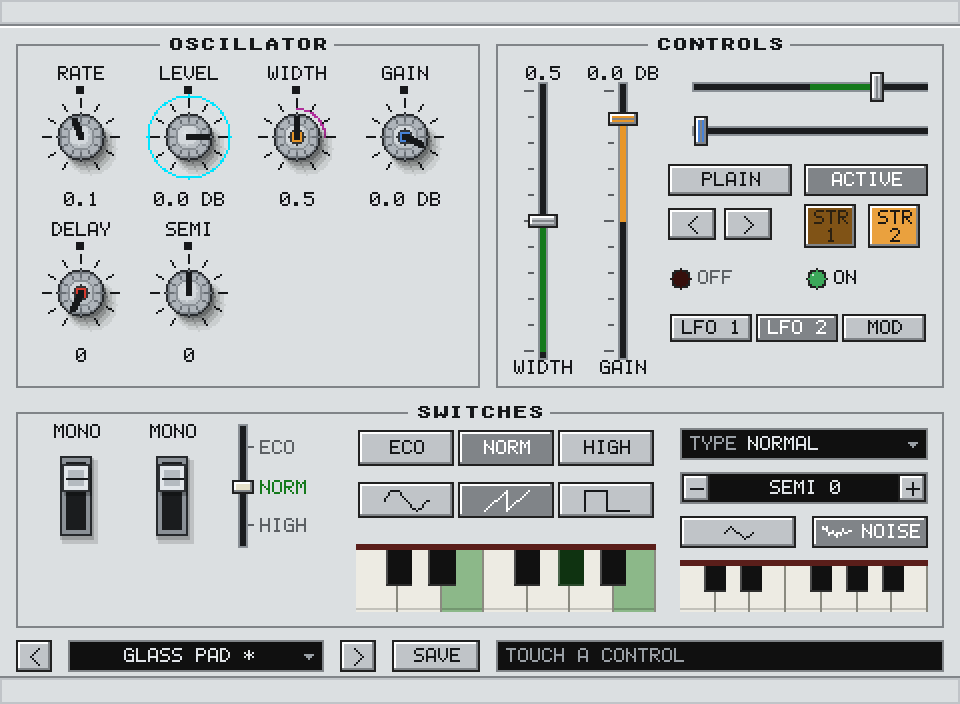 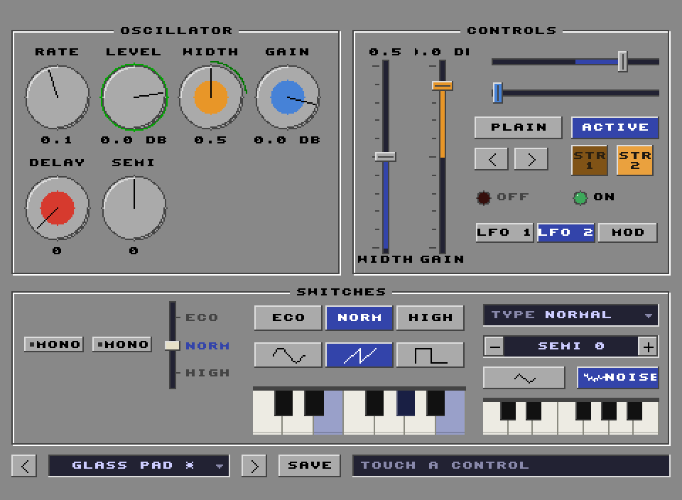 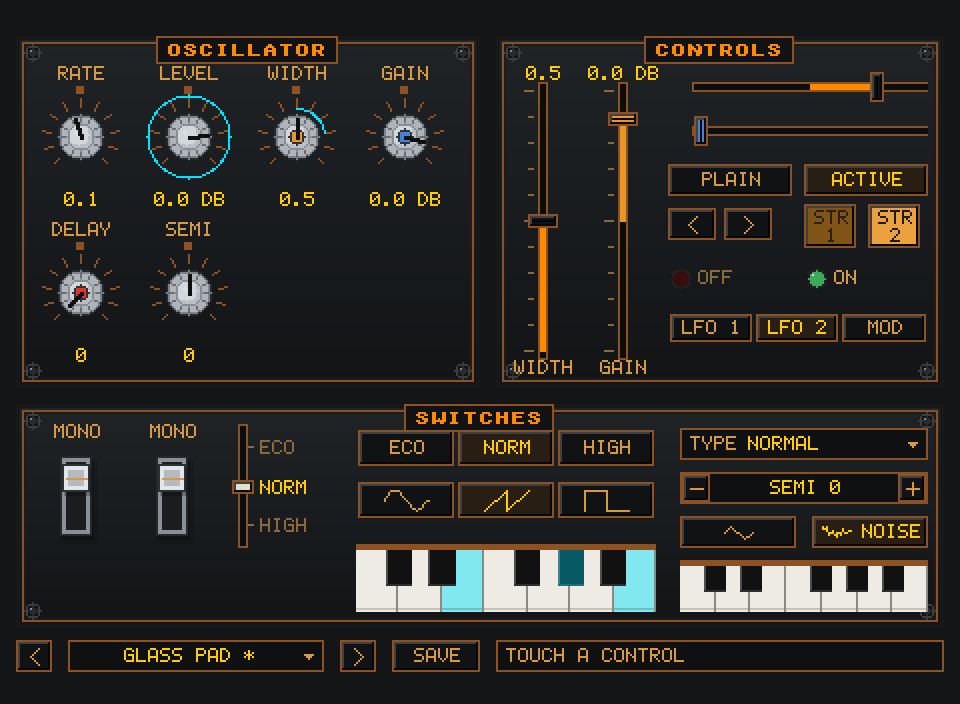

Retro draws whole pixels only; the images are made at the real size and shown at 2x.

| Control | Call | Classic, slate | Classic, silver | Classic, forge | Modern | Retro | Notes |
| --- | --- | --- | --- | --- | --- | --- | --- |
| Knob | `g.knob(id, rect, {…})` | 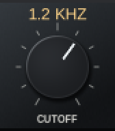 | 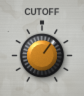 | 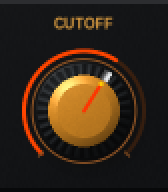 | 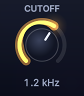 | 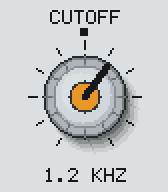 | Rotary parameter control. Value and label rows; bipolar scale; typed value entry. Classic: disc or knurled, printed ticks or circular arcs (config). Retro: fluted with printed ticks (silver, forge) or a flat bevelled disc (tracker). |
| Knob, modulated and pickable | `g.knob(…, {.pickable=true})` + the host's `ModulationHost` | 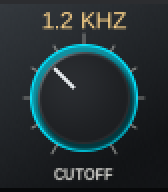 | 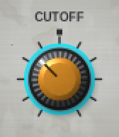 | 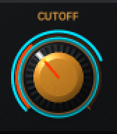 | 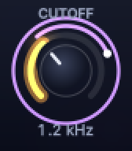 | 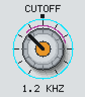 | The live modulated value on its own arc, and a highlight while the knob can be picked (a modulation target, MIDI learn). Classic draws the arc in looks that have arcs (forge); Modern draws rings, voices and the depth handle; Retro draws the swing between the knob's own value and the modulated one as a one-pixel arc just outside the dial, and the pick highlight as a ring. |
| Slider, vertical | `g.slider(id, rect, {.vertical=true})` | 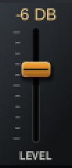 | 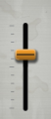 | 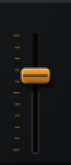 | 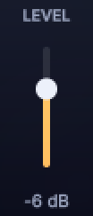 | 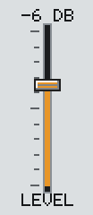 | Fader with scale (`slider.slotW`, `slotEnd` and `scaleBothSides` in `ClassicConfig`). Jump or relative drag. |
| Slider, horizontal | `g.slider(id, rect)` | 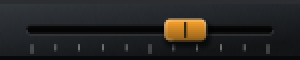 | 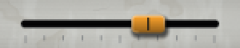 | 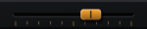 | 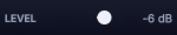 | 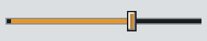 | Classic prints no label or value for the horizontal fader yet; Retro prints them above and below the slot when the bounds leave a text row. |
| Toggle | `g.toggle(id, rect, {…})` | 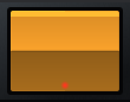 | 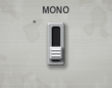 | 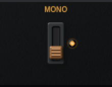 |  | 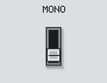 | Classic: rocker key (slate) or lever switch (silver, forge: with a lamp), chosen by the config. Retro: a lever in a slot (silver, forge) or a bevelled key with a lamp (tracker). |
| Selector | `g.selector(id, rect, {.labels=…})` | 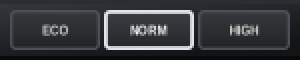 | 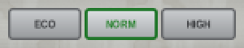 | 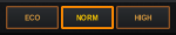 | 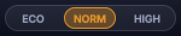 | 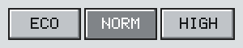 | Segments for a few choices. |
| Selector, vertical | `g.selector(id, rect, {.vertical=true})` | 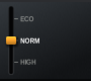 | 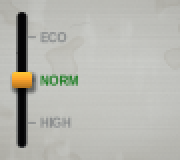 | 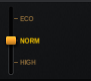 | 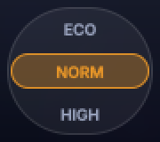 | 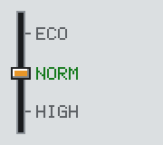 | A lever in a slot (Classic) or a column of segments (Modern). |
| Selector with icons | `g.selector(id, rect, {.icons=…})` | 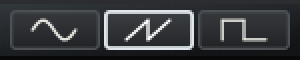 | 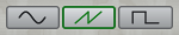 | 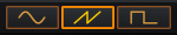 | 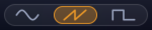 | 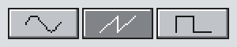 | Icons replace the labels; any `Icon`, built-in or the plugin's own. |
| Button | `g.button(id, rect, label, {…})` | 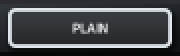 | 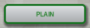 | 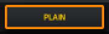 | 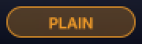 | 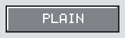 | Plain, on, hot, pressed. Classic also has the cap button (colored, two-line legend); Modern the chip. |
| Button with icon | `g.button(id, rect, label, {.icon=…})` | 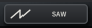 | 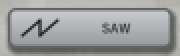 | 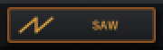 |  |  | An icon beside the label, or alone when the label is empty. |
| Button, arrows | `{.variant=kButtonArrowLeft/Right}` |  |  |  |  |  | Previous and next; every flavor draws them (`StdButtonVariant`). |
| Button, display | `{.variant=kButtonDisplay}` |  |  |  |  |  | A recessed display of a name that opens something; every flavor draws it. |
| LED | `g.led(id, rect, on, {…})` |  |  |  |  |  | A lamp with a label and a level. No input. Its own painter interface (`LedPainter`). |
| Keyboard | `g.keyboard(id, rect, {…})` returns `KeyboardEvents` |  |  |  |  |  | Piano keys `first..last`; reports press, release, velocity and glide; the plugin sends the notes. Sounding keys are shown from `lit`. |
| Tabs | `g.tabs(id, rect, labels, n, current)` returns the index |  |  |  |  |  | A row of tabs; the selection is the page's state. |
| Readout | `g.readout(id, rect, {.idle=…})` |  |  |  |  |  | Name, value and hint of the parameter being dragged or under the pointer. |
| Dropdown | `g.dropdown(id, rect, label)` or `{.drag=true}` |  |  |  |  |  | Opens the popup list for an enum or integer parameter; with `drag` a vertical drag steps through the values and a click still opens the list. |
| Stepper | `g.stepper(id, rect, label)` |  |  |  |  |  | [-] value [+]. |
| Text field | `g.textField(id, rect, text)` |  |  |  |  |  | Modal single-line entry (preset names). |
| Panel / frame | `g.panel(rect, title)` |  |  |  |  |  | Classic: a titleless panel is the surface (gradient, brushed steel or worn paint), a titled one a frame, or a forged plate with rivets (forge). Modern: glass panel. |
| Popup menu | `g.popup(…)` |  |  |  |  |  | Lists with columns, separators and disabled items, and submenus: a row with `PopupItem::children` opens its list beside it under the pointer, to any depth, and `popupPath(…, choose(path))` reports the route. |
| Tooltip | (automatic on parameters) |  |  |  |  |  | Shown after hovering a parameter. |

The **preset bar** (`presetBar(gui, id, rect)`, `spux/ui/PresetBar.hpp`) is not a painter: it is arrow buttons, a display button and
a list popup arranged over the host's `PresetHost`, so it looks like whichever flavor draws it. It reports SAVE; naming a
preset is the plugin's page.

## Retro looks

The same controls in the other two Retro looks (the silver look is the Retro column above). Each look is a `RetroConfig`:
`RetroConfig::silver()`, `tracker()` and `forge()`; a plugin starts from one and changes what it wants (colors, fonts, knob and
toggle shapes, bevels, the rows around a knob). Each look lives in its own object, so a program links only the faces of the look it uses.

| Control | Retro, tracker | Retro, forge |
| --- | --- | --- |
| Knob |  |  |
| Knob, modulated and pickable |  |  |
| Slider, vertical |  |  |
| Slider, horizontal |  |  |
| Toggle |  |  |
| Selector |  |  |
| Selector, vertical |  |  |
| Selector with icons |  |  |
| Button |  |  |
| Button with icon |  |  |
| Button, arrows |  |  |
| Button, display |  |  |
| LED |  |  |
| Keyboard |  |  |
| Tabs |  |  |
| Readout |  |  |
| Dropdown |  |  |
| Stepper |  |  |
| Text field |  |  |
| Panel / frame |  |  |
| Popup menu |  |  |
| Tooltip |  |  |

## Icons

Waveforms nearly every oscillator wants are built in (`spux/ui/Icons.hpp`, the `Wave` enum in `spux/core/Wave.hpp`, shared with
the LFO): sine, triangle, saw, saw down, square, pulse, noise, sample and hold. They draw through the basics of `IRenderer`, so
every flavor shows them. A plugin makes its own icon with one function and passes it where the built-in ones go.


## Views (Modern only so far)

| View | Call | Classic | Modern | Retro |
| --- | --- | --- | --- | --- |
| Spectrum | `drawSpectrum(style, g, …)` | not started |  | not started |
| Traces | `drawTraces(style, g, …)` | not started |  | not started |
| Stereo meter | `drawStereoMeter(style, g, …)` | not started |  | not started |
| Curve editor | `drawCurveEditor(style, g, …)` | not started |  | not started |

## Not implemented

| Control | Where it stands |
| --- | --- |
| Level meter bar (peak, VU, segments) | The data side exists (`LevelMeter`, `History` in `spux/ui/Live.hpp`); no painter in any flavor except Modern's stereo meter view. `PixelRenderer::drawMeter` draws a column of segments for a plugin's own view. |
| Modulation display in slate and silver | The forge look draws arcs; slate and silver draw none unless their config turns `knob.arc` on. |
| Multi-target modulation control (drag a source onto a knob, set the depth on a ring, as in Vital) | Not built. The pieces are there: `ModMatrix` holds many routes per source, `ModulationHost` shows live values and the armed source's depth handle, `KnobState::pickable` highlights targets. |
| XY pad | Not started. |
| Envelope and filter-response editors | Not started; generic ones may come after the second plugin needs them (Plumeflow's stay in the plugin). |
| Preset browser | An optional target is planned (`spux_presetbrowser`, a placeholder); the preset bar covers the header. |
| Scroll area / long lists | Built for popups in all three flavors: lists taller than the view height scroll by windowing rows, with mouse wheel, keyboard, up/down buttons and scroll marker. |
| Cascading submenus in the popup | Built in all three flavors (U9): a chevron marks the row, the list opens beside it (to the left at the edge of the view); no keyboard navigation of submenus yet. |
| Retro in whole-step scales (U11) | Not built: the editor draws a CPU flavor at its logical size, so a Retro plugin that wants 2x or 3x scales the blitted frame itself. |
| Retro spectrum, traces and curve editor | Not started (Modern only). |
| Classic spectrum, traces, curve editor | Not started (Modern only). |

## Plugin territory (not shared)

Widgets that belong to one plugin stay there, built on `Gui::view`, `Gui::interact` and `ShadedRenderer::graphics()`: for
example Tannhauser's ribbon, paddles, tone selector legends and LCD readout, Acidus's printed waveform symbols and logo plate,
Gritbaal's routing summary text, Plumeflow's attractor, envelope and signal-flow views.
